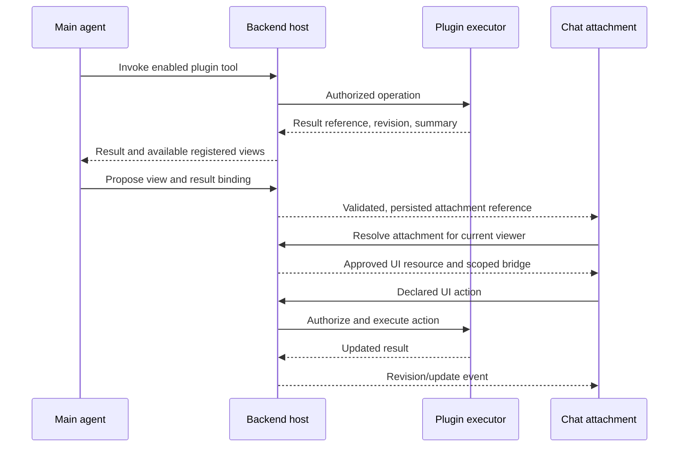

# Plugin UI and chat attachment contract

**Status: proposed, not implemented.** Revision 1, 24 October 2026.

This document specifies the missing shared contract for displaying a hosted
plugin's UI as an interactive attachment in chat. It complements PRD-112's
capability/runtime model and PRD-108 §28.5's plugin-authored view boundary.
Executable plugin development uses the [development guide](./plugin-development.md).

The Bahulam registration and attachment fields below are proposed. The external
MCP Apps protocol already exists; integration into Bahulam remains work to do.
This documentation provides no new SDK, registration loader, or hosted attachment
renderer. Keep proposed fields out of production manifests until implemented.

## 1. User experience and execution flow

Example: a user asks to review a campaign. The plugin tool saves the review. The
assistant replies with a short explanation and a campaign-review attachment.
The attachment shows findings and available actions. Expanding it opens the
same review. Clicking an action invokes the authorized backend operation and
updates the review; changing tabs or expanding a card needs no model call.



The proposal can accompany the existing agent response. It does not require a
separate model. A registered default view may skip model selection entirely.

## 2. Standard boundaries

| Layer | Owns |
| --- | --- |
| Plugin author | Domain tools, result schema, view code and supported actions |
| Main agent | Selecting a useful enabled view and binding it to actual results |
| Backend host | Deployment resolution, validation, permissions, durable attachment, actions and audit |
| Chat host | Attachment card, loading/error UI, theme, sizing, expand/open, accessible fallback |
| Renderer | Displaying validated input, emitting declared interactions, releasing resources |

Register authored UI code at release/deployment time. At conversation time,
agents supply data references and a view choice. They cannot supply executable
HTML, JavaScript, bundle URLs, or a new renderer implementation.

Use existing `bahulam_render_v1` widgets for ordinary charts/tables/cards. Use a
plugin attachment for a result that needs its own interaction. A plugin can
use Workplane internally; its native renderer specification is validated by
that adapter, without translating everything into a new chart grammar.

## 3. Proposed view registration

### Use MCP Apps for hosted MCP views

MCP Apps defines tool-linked `ui://` resources, sandboxed UI, initialization,
tool-result delivery, and communication with the host. Use its existing SDK and
protocol for hosted MCP plugins. See the official
[MCP Apps overview](https://apps.extensions.modelcontextprotocol.io/api/documents/Overview.html).

The tool's `_meta.ui.resourceUri` identifies an HTML resource with MIME type
`text/html;profile=mcp-app`. Support is negotiated using
`io.modelcontextprotocol/ui`; clients without support receive ordinary tool
output. Pin the implementation to a supported specification/SDK version.
See the [2026-01-26 specification](https://github.com/modelcontextprotocol/ext-apps/blob/main/specification/2026-01-26/apps.mdx).

Bahulam's proposed registration adds package identity, deployment policy, and
durable result binding around that protocol. Preserve MCP UI metadata and
resource access through the gateway. An MCP connection alone is insufficient;
the chat client must implement the app host. For local/non-MCP plugins, an
adapter can expose the same view services without changing domain logic.

The registry stores this metadata alongside an immutable plugin release. The
example is a proposed registration record, **not an accepted `plugin.yaml`
extension**. The loader must be implemented before authors can publish it.

```json
{
  "schema_version": "bahulam.plugin-ui/1",
  "plugin_id": "campaign-studio",
  "plugin_version": "0.1.0",
  "views": [{
    "id": "campaign-review",
    "title": "Campaign review",
    "description": "Review saved findings and record a disposition.",
    "entry": "workspace/review.html",
    "surfaces": ["workspace", "chat"],
    "display_modes": ["compact", "expanded"],
    "resource_types": ["campaign-review"],
    "input_schema": "schemas/review-view-input.json",
    "bridge": {
      "protocol": "mcp-apps",
      "spec_version": "2026-01-26",
      "resource_uri": "ui://campaign-studio/review"
    },
    "actions": [{
      "id": "record-disposition",
      "tool": "campaign_record_disposition",
      "input_schema": "schemas/record-disposition.json",
      "effect": "write",
      "approval": "explicit"
    }],
    "fallback": { "required": true }
  }]
}
```

These campaign filenames and tool names illustrate the contract; they do not
claim that the existing campaign-studio plugin implements this view.

Registration rules:

- `entry` and schema paths resolve inside a verified package. The deployment
  registry supplies the approved asset origin, immutable digest, and deployment
  binding. No conversation-provided URL overrides them.
- The MCP resource must resolve to the approved UI for that release. Resolve and
  verify it through the registered server/deployment, not an arbitrary server
  supplied in a message. Check that gateways preserve the necessary metadata.
- View IDs are stable within a plugin; view changes are versioned with the
  package. Missing versions yield a fallback, not a silent upgrade.
- `resource_types` and input schemas determine which results a view accepts.
  The host resolves actual resources and checks the schema before mounting.
- Each action maps to a declared, enabled tool with an argument schema. Policy
  may narrow that declaration further; the declaration grants no permission.
- Advertise only the views the current host can render and the viewer can use.
  Availability is the intersection of registration, deployment health, surface
  support, enablement, and access policy.
- Hosted releases serve a pinned UI bundle with required assets and theme
  support. They must not depend on the CLI's `/vendor/...` endpoint existing.

## 4. Proposed durable attachment

Add a distinct assistant presentation type. Today's `ChatMessage.attachments`
contains uploaded `ChatFileRef` records; do not encode a plugin view as a fake
upload or assume the upload APIs can resolve it.

```json
{
  "schema_version": "bahulam.plugin-attachment/1",
  "type": "plugin_view",
  "attachment_id": "pva_example_01",
  "plugin": { "id": "campaign-studio", "version": "0.1.0" },
  "view_id": "campaign-review",
  "title": "Campaign review",
  "resource": {
    "ref": "result_example_42",
    "revision": "7",
    "mode": "snapshot"
  },
  "display_mode": "compact",
  "fallback": {
    "text": "Review complete: three findings need attention.",
    "open_ref": "result_example_42"
  }
}
```

The backend issues `attachment_id` and resolves references; IDs are not bearer
credentials. Its private binding stores principal/organization, workspace,
conversation, message, run/tool-call provenance, deployment, and policy context.
Never accept those authority bindings from the model or frame.

The main agent proposes only `{plugin_id, view_id, resource_ref, display_mode}`
plus an optional title. The server chooses the enabled version, checks result
ownership/type and host capability, creates the fallback, and persists the
attachment. In v1, domain data comes from the bound result. Add view-specific
input only through its registered schema; unknown fields are rejected.

Persist this in the canonical chat store and carry it through streaming,
history loading, branching, export, deletion, and sharing. A small reference
may appear in a tool result for transport compatibility; the durable record
must survive tool-result truncation. It cannot depend only on frontend activity
state. When replaying a conversation to the model, include its summary and
resource identity, not the UI bundle or browser-only bridge metadata.

### Snapshot and live behavior

- **Snapshot (default):** bind an immutable result revision and retain the
  referenced data under the result retention policy. Reloading the chat shows
  the original evidence. If that revision was deleted, show unavailable.
- **Live:** explicitly label the card as live, retain the revision originally
  shown, and display the current revision and refresh time. Updates do not
  silently rewrite the historical summary.
- Actions against a snapshot must name an expected current revision. If state
  has changed, return a conflict and offer refresh/review; never overwrite it.
- Deduplicate reconnects and retries by attachment ID and originating turn/tool
  call. Mounting or restoring a view never re-executes the originating operation.
- A shared conversation grants no automatic access to the plugin's resources.
  Recheck the viewer; show a permitted summary or access-required placeholder.
  Apply the sharing policy to summaries and previews as well as live data.

## 5. Host bridge

Define a small transport-neutral interface inside the host. A local adapter
wraps existing HTTP/events; a hosted MCP adapter uses MCP Apps. The following
names describe host services, not a competing set of wire messages or a
published Bahulam SDK. Map them to the negotiated protocol and backend services.
View components must not depend on CLI internals or hard-coded backend URLs.
Map compact/expanded presentation to the display modes negotiated with the
app; use a host open action when the requested mode is unavailable.

| Proposed operation | Behavior |
| --- | --- |
| `initialize` | Negotiate version; supply instance identity, theme, locale, mode, limits, permitted actions, and initial result |
| `readResource` | Read only the attachment's authorized result and approved related references |
| `invokeAction` | Submit registered action ID, schema-checked input, request ID, and expected revision |
| `subscribe` | Subscribe to this binding's changes; return revision/cursor for reconnect |
| `requestResize` | Request a height; host clamps it to the surface budget |
| `requestExpand` | Open the same attachment in its expanded presentation |
| `openReference` | Ask the host to resolve and open an approved artifact/source reference |
| `dispose` | Cancel subscriptions and pending reads, release view resources |

Responses correlate to request IDs. Errors have a stable code and safe message:
`invalid_input`, `forbidden`, `approval_required`, `conflict`, `unavailable`,
`unsupported_version`, or `cancelled`. The host bounds payload sizes, rate,
timeouts, and concurrent requests; it supplies effective limits at initialize.

For a hosted iframe:

1. Serve reviewed plugin assets on an origin isolated from the authenticated
   chat application. Apply the sandbox and CSP appropriate to that origin;
   deny undeclared network destinations and browser capabilities.
2. Use the protocol SDK's sandbox/initialization transport and bind it to the
   expected frame instance. Validate origins and source windows at the proxy
   boundary. Do not replace its transport with an incompatible custom handshake.
   Any local adapter must provide equivalent instance and origin validation.
3. Authorize every bridge operation on the server. An initialized bridge is not
   data access authorization. Reject messages from stale,
   replaced, or disposed instances.
4. Keep account cookies, OAuth tokens, local session tokens, and credential
   leases out of plugin props, URLs, persisted messages, and browser storage.
5. Dispose the channel on navigation, revocation, or unmount. Refetch authorized
   state after reconnect; do not trust an event to be a complete state snapshot.

These are hosted bridge requirements. The current local same-origin iframe and
session-token API do not establish tenant isolation for hosted plugins.

## 6. Action execution

All UI mutations use the same domain tools and policy path as agent actions.

```text
view action ID + input + expected revision + request ID
  → host resolves bound tool and resource
  → authenticate viewer; authorize tenant/resource/tool
  → validate arguments and current revision
  → host approval when required
  → execute through existing runtime/broker
  → persist outcome and audit; emit update
```

The view cannot call an arbitrary tool name or submit SQL. Grant only the
actions registered for this view and permitted for this viewer. Host-rendered
approval must bind the exact operation, resource, revision, and arguments;
changing any of them invalidates approval.

For writes, deduplicate request IDs within the authorized operation scope and
retain operation status. After a timeout, query that status before retrying.
Cancellation of the browser request does not imply that an external write was
rolled back. Reuse the platform's existing operation/audit facilities.

Filtering, expanding, and deterministic tool actions need no LLM. If an action
means “ask the agent,” make that explicit in the UI and record the resulting
agent turn so its latency and cost are visible.

## 7. Visual and lifecycle standard

The chat host supplies the plugin identity/title, result status, expand/open
controls, permission/approval UI, and error boundary. The plugin supplies the
domain content inside the attachment. Avoid a second application navigation bar
inside a compact card.

Required behaviors:

- Compact layout fits a 320 CSS-pixel container without page-level overflow.
  Wide tables scroll within their region; large editors open expanded.
- Expanded and compact modes use the same attachment/resource identity. Do not
  lose selection or unsaved edits when changing mode.
- Map host theme tokens to CSS variables, including `--ws-bg`, `--ws-panel`,
  `--ws-fg`, `--ws-muted`, `--ws-border`, `--ws-primary`, and semantic status
  colors. Update on theme changes and honor reduced motion.
- Provide readable loading, empty, stale/disconnected, denied, and failed
  states. Failures stay inside the attachment and leave the chat usable.
- Support keyboard navigation, visible focus, labeled controls, a meaningful
  iframe title, and a text/table equivalent for visual results.
- Suspend expensive rendering and subscriptions when appropriate; dispose
  listeners, timers, object URLs, WebGL objects, and bridge resources on unmount.
- Default to read-only text/preview plus an authorized open action on unsupported
  clients. Mobile v1 uses this fallback unless an explicitly supported renderer
  is available; declaring `chat` does not imply mobile iframe support.

Source links and artifacts resolve through the host under current permissions.
An arbitrary web page is not an embeddable plugin UI merely because it has a URL.

## 8. Implementation plan

Implement one vertical slice with an existing plugin and one read-only result
view, then add a single controlled mutation. Reuse the platform agent/runtime;
introducing another model or hosted CLI loop is not a prerequisite.

| Step | Deliverable | Main locations |
| --- | --- | --- |
| 1 | Versioned registration/attachment schemas and matching fixtures; pin MCP Apps compatibility; backend validation and generated/shared client types | Plugin registry; `codekepler-backend`; `appstak-platform/packages/chat-render` |
| 2 | View discovery, enabled deployment resolution, authorized result binding and durable attachment storage | Existing backend capability/runtime and chat persistence services |
| 3 | Streaming and history support with deduplication and fallback | `packages/chat-client`, backend chat serializers/readers |
| 4 | Shared web attachment container and MCP Apps host adapter; native/mobile fallback | `packages/chat-render-web`, `packages/chat-render-mobile`, web `ChatThread` |
| 5 | Registered actions, approval, revision conflicts and operation audit | Existing executor, policy, connector/broker services |
| 6 | Reference plugin, local adapter, hosted adapter, author docs and conformance examples | This repository and `codekepler-npm` |

Use one canonical wire schema to generate or validate TypeScript and backend
models; independently maintained lookalike types will drift. Extend the existing
chat render registry deliberately, with a separate attachment version and
unknown-version fallback. Do not reinterpret old `bahulam_render_v1` payloads.

### Release acceptance criteria

- A real tool result produces an attachment during streaming and after reload.
- Selecting a view adds no separate model invocation; UI-only actions add none.
- Compact/expanded views show the same result; original snapshot remains stable.
- Reconnect/retry neither duplicates the attachment nor repeats a write.
- A second tenant or unauthorized shared-chat viewer cannot resolve data,
  actions, previews, or asset sessions belonging to the first.
- Unknown view/version, missing deployment, deleted result, offline host, and
  revoked access produce a useful fallback.
- Invalid messages, undeclared actions, stale revisions, and changed approval
  arguments are rejected at the server boundary.
- Desktop narrow/wide, mobile fallback, keyboard, theme change, and dispose/reopen
  are exercised with the reference plugin.
- Existing charts, tables, uploaded attachments, chat history, and plugin local
  panels continue to work.

## 9. Evidence and related contracts

Source paths below are relative to their named repositories. This is the code
review baseline; it is not a claim of deployed hosted-attachment support.

| Repository | Evidence |
| --- | --- |
| `codekepler-npm` | `src/plugins/manifest.mjs`, `src/plugins/preflight.mjs`, `src/local-service/server.mjs`, `assets/bahulam-plugin/bahulam-plugin.css` |
| `appstak-platform` | `packages/chat-render/src/index.ts`, `packages/chat-client/src/types.ts`, `packages/chat-client/src/stream.ts`, `apps/bahulam/src/components/chat/ChatThread.tsx` |
| `codekepler-backend` | `app/chat/render_widgets.py`, `app/chat/content_blocks.py` |
| Platform PRDs | PRD-101 plugin packaging; PRD-104.1 execution isolation; PRD-108 §28.5 plugin view boundary; PRD-112 capabilities and outcome runtime; PRD-117 credential-isolated connections |

Today the chat render union has structured widgets and the upload type represents
files. Neither defines this plugin attachment. The CLI capability graph is
descriptive; it does not prove that hosted deployment, policy, or UI resolution
has been implemented. Those gaps are the delivery scope above.
