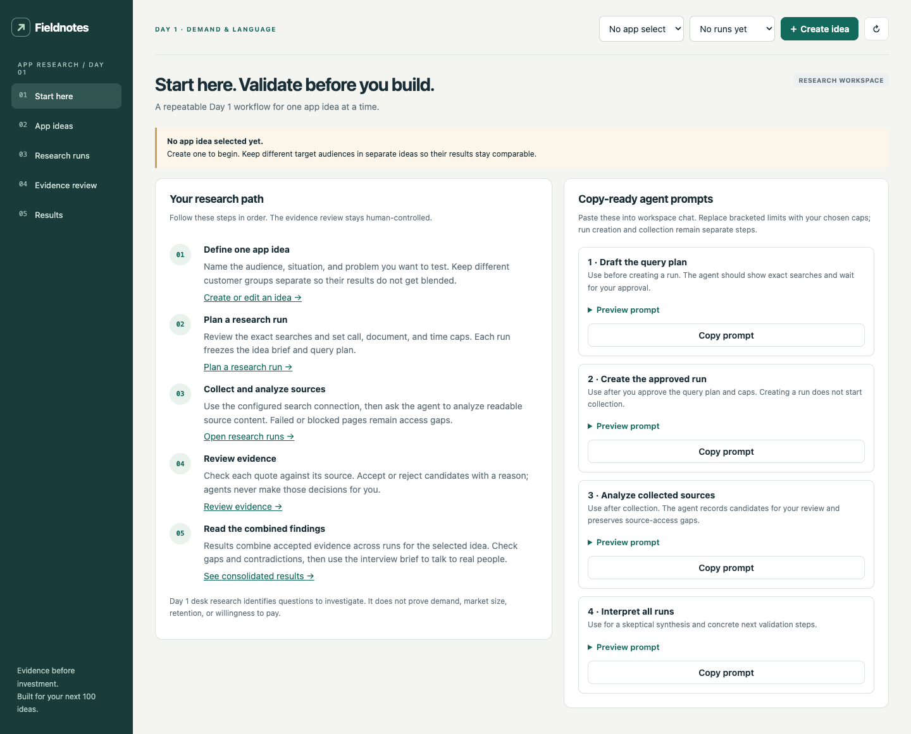

# App Research

App Research is a Day 1 validation workspace for testing one app-idea hypothesis
at a time. It collects traceable source material, asks agents to propose
evidence, keeps human review in control, and consolidates findings across runs.



The first **Start here** panel explains the workflow and includes copy-ready
agent prompts. Five workspace panels cover the full process: **Start here**,
**App ideas**, **Research runs**, **Evidence review**, and **Results**.

## Install

Requirements: Node.js 22.13+, Bahulam Code, and a Bahulam login for agent/tool
execution. The core plugin has no npm runtime dependencies.

Install from the registry:

```bash
bahulam install app-research
bahulam plugin app-research /path/to/your/project
```

Or install from a local checkout:

```bash
bahulam install ./plugins/app-research
bahulam plugin app-research /path/to/your/project
```

Collection uses the Brave Search API. Configure `brave_api_key` in plugin
Settings, or set `BRAVE_API_KEY` in the runtime environment. Source imports work
without a key. Search-call counts are recorded by the plugin; billed search
usage is visible in your Brave dashboard. Agent/model usage is not metered here.

## Start a study

1. Open **Start here** and select **Create idea**. Write a specific problem
   hypothesis and define the audience. Keep distinct customer groups as
   separate app ideas so their findings do not get merged.
2. In **Research runs**, review and edit the exact queries. Include problem
   reports, current alternatives/workarounds, and contrary evidence. Set search,
   document, and collection-time caps before creating the run.
3. Configure Brave Search, then start collection. The panel checkpoints work
   after each step; pause and resume are supported. Inaccessible pages stay
   visible as source-access gaps.
4. After collection, ask the agent to analyze stored, readable source content.
   It proposes source-matched candidates; it does not accept evidence or record
   a final outcome.
5. In **Evidence review**, inspect source context and quotes, then accept or
   reject each candidate with a reason. Imported excerpts require an explicit
   check against the original source.
6. In **Results**, review accepted evidence, counterevidence, coverage, and gaps
   across every run for the selected app idea. Generate the consolidated pack,
   then take the questions to real customer conversations.

Five interviews and direct willingness-to-pay tests remain outside Day 1 desk
research. Market-size estimates, app-store reviews, and vendor articles do not
by themselves establish demand.

## Copy-ready agent prompts

The **Start here** panel has these prompts with preview and copy buttons. Limits
marked `[N]` are placeholders; fill them in before asking the agent to create a
run.

**Draft a query plan**

> Draft a Day 1 query plan for the selected app idea and its saved audiences.
> Cover first-person problem reports, current workarounds and alternatives,
> and contrary evidence for every audience. Show every exact query and ask me
> to approve the plan before creating a run. Search-call cap: [N].
> Document-attempt cap: [N]. Active collection limit: [N] minutes. Do not
> collect sources.

**Create the approved run**

> Create a research run for the selected app idea using the exact query plan
> and caps I approved above. Check for an existing duplicate first. Create the
> run only; do not start collection.

**Analyze collected sources**

> Analyze the stored source snapshots for the selected run. Fetch source
> content before evaluating it; skip empty, failed, and metadata-only sources
> as access gaps. Delegate to the demand analyst and demand skeptic. Record
> only exact source-matched evidence, preserve contradictions and unknowns,
> and do not accept/reject evidence or record an outcome.

**Interpret all runs**

> Summarize the consolidated results across all runs for the selected app
> idea. Separate direct, unprompted first-person evidence from adjacent,
> prompted, and vendor content. Include counterevidence, source quality,
> collection/analysis/review gaps, and distinct complaint groups. Do not treat
> market-size estimates or accepted-record counts as proof of willingness to
> pay. Recommend the next interviews or validation experiment.

## Agent tools

Every plugin tool accepts JSON arguments. These examples show the minimum useful
shape; required fields and constraints are defined in `plugin.yaml`.

| Tool | Example arguments | Purpose |
|---|---|---|
| `research_dashboard` | `{"app_id":"<app-id>"}` | Read selected idea, runs, source metadata, evidence, and readiness. |
| `research_app_save` | `{"config":{"name":"Example","brief":"Test one problem hypothesis.","audiences":["One specific audience"],"hypotheses":[{"id":"H1","statement":"The problem recurs."}],"country":"US","language":"en","criteria":{"direct":10,"contexts":3,"families":2,"consequences":5,"months":24}}}` | Create or update an app brief. Existing runs keep their frozen snapshots. |
| `research_run_create` | `{"app_id":"<app-id>","queries":[{"query":"<approved query>","audience":"<audience>","intent":"pain"}],"budgets":{"queries":24,"documents":60,"minutes":30}}` | Create a run from an explicit query plan and caps. |
| `research_run_limits_update` | `{"run_id":"<run-id>","queries":40,"documents":100,"minutes":60}` | Change caps on a queued or paused run without changing its query plan. |
| `research_collect` | `{"run_id":"<run-id>"}` | Advance one bounded search or fetch step. |
| `research_run_control` | `{"run_id":"<run-id>","action":"pause"}` | Pause, resume, cancel, or retry permitted failed steps. |
| `research_run_delete` | `{"run_id":"<run-id>","confirm_run_id":"<same-run-id>"}` | Permanently delete a run and its child research. UI only; unavailable to agents. |
| `research_source_get` | `{"run_id":"<run-id>","source_id":"<source-id>"}` | Read a stored source snapshot. |
| `research_source_import` | `{"run_id":"<run-id>","url":"https://example.org/source","content":"<excerpt>","provenance_note":"<how collected>"}` | Import one source excerpt with provenance. |
| `research_sources_import` | `{"run_id":"<run-id>","format":"json","data":"[{\"url\":\"https://example.org/source\",\"content\":\"<excerpt>\",\"provenance_note\":\"<how collected>\"}]"}` | Validate and import a JSON or CSV batch atomically. |
| `research_source_annotate` | `{"run_id":"<run-id>","source_id":"<source-id>","family":"community","published_at":"2026-01-15","context_id":"<thread-or-context>"}` | Add source family, date, thread, or provenance context. |
| `research_evidence_record` | `{"run_id":"<run-id>","source_id":"<source-id>","quote":"<exact source quote>","relevance":"direct","direction":"supports","unprompted":"yes","rationale":"<source-grounded reason>"}` | Record an unreviewed candidate tied to a source. |
| `research_analysis_done` | `{"run_id":"<run-id>","source_id":"<source-id>","note":"<analysis result or reason no candidate was found>"}` | Mark a readable source analyzed. Inaccessible sources need a gap note. |
| `research_evidence_review` | `{"run_id":"<run-id>","evidence_id":"<evidence-id>","decision":"accepted","reason":"<human review reason>"}` | Record a human accept/reject decision or correction. |
| `research_source_remove` | `{"run_id":"<run-id>","source_id":"<source-id>","reason":"<why remove>"}` | Remove a source and invalidate exports that depend on it. |
| `research_outcome_record` | `{"run_id":"<run-id>","outcome":"continue","reason":"<evidence-based rationale>"}` | Record a requested research outcome. It is not a market-validation verdict. |
| `research_export` | `{"app_id":"<app-id>"}` | Generate a versioned research pack across the app's runs. |
| `research_artifact_get` | `{"app_id":"<app-id>","artifact_id":"<artifact-id>"}` | Retrieve a generated pack. |

## Data and limitations

Research state is stored locally by Bahulam in
`~/.bahulam/data/app-research/state.db` (or the configured `BAHULAM_HOME`).
Source snapshots stay in that database. Exports are generated on request and
never automatically committed or added to a project.

The collector is bounded by search-call, document-attempt, and active-time
caps. It is not an unattended hosted worker: the local runtime must stay
available while it advances. Source retrieval does not bypass bot blocks,
logins, rate limits, or other access controls. Reddit, YouTube, and review-site
specific adapters are not included. Exact quote and URL deduplication is
implemented; semantic near-duplicate and cross-author detection are not.

## Validation

```bash
node selftest.mjs
npm test
BAHULAM_RUNTIME=/path/to/codekepler-npm npm run check:runtime
node scripts/browser-smoke.mjs --playwright /path/to/playwright --browser /path/to/chrome
```

The test fixtures are synthetic and do not establish market demand or model
quality. The browser smoke test exercises the five panels, idea creation,
source review, and export without calling a paid model.
